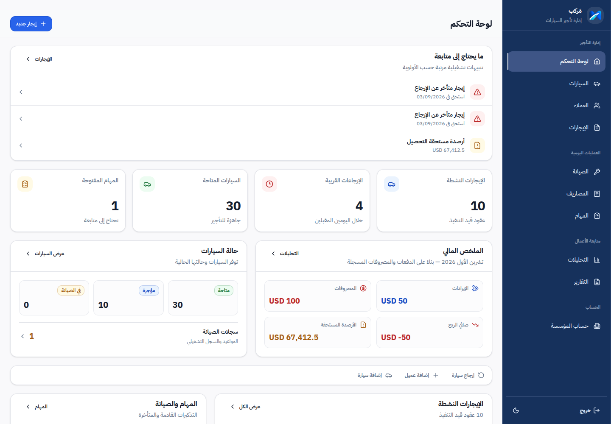
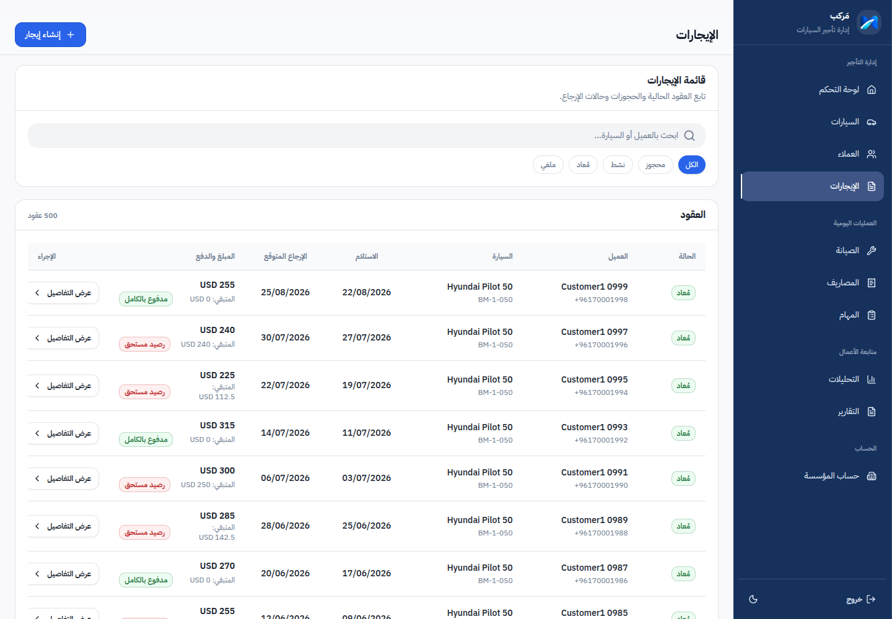
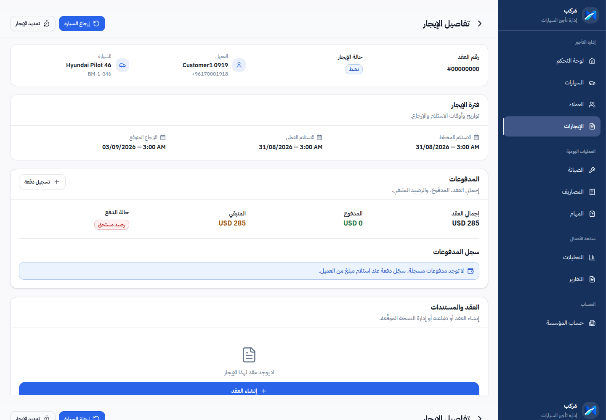
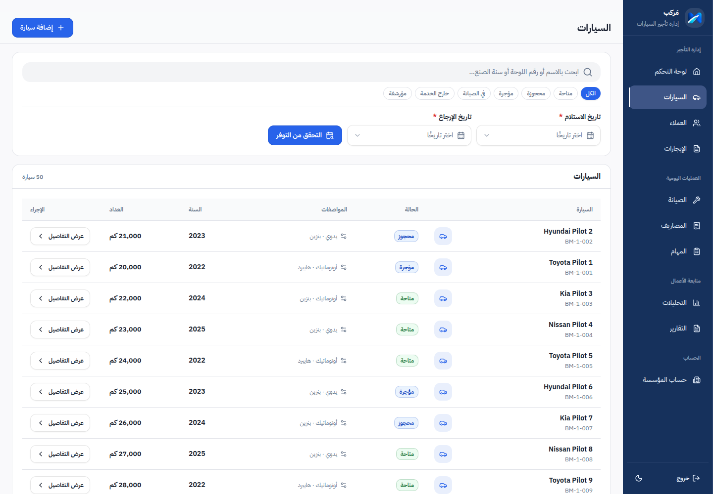
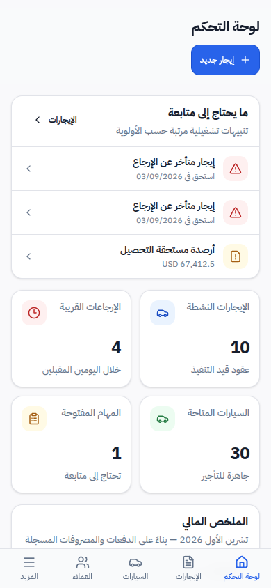
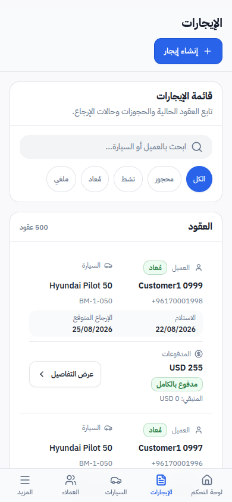
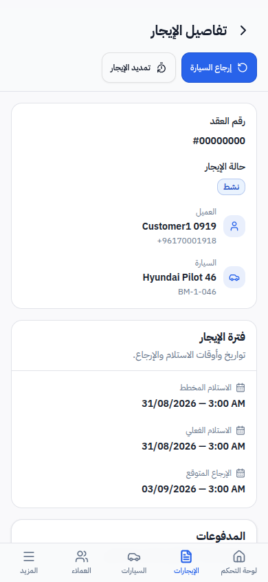
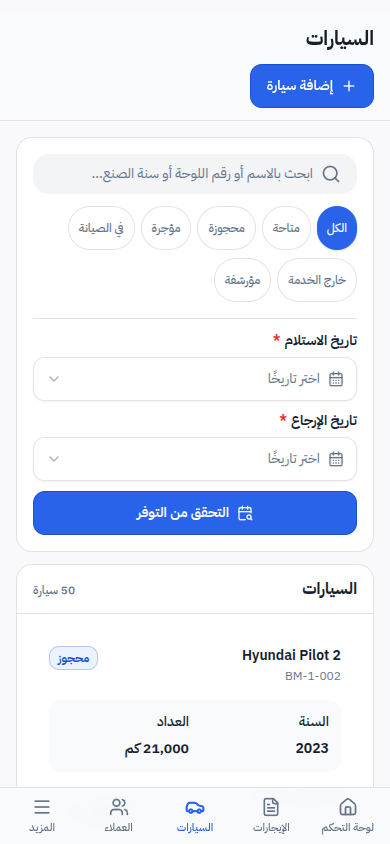

# Markab — مَركب

**Production-ready, Arabic-first vehicle rental management SaaS built for rental businesses.**

Markab is a full-stack, multi-tenant platform for managing vehicles, customers, rentals, payments, maintenance, expenses, tasks, analytics, and operational workflows from one system.

The application is designed around real rental-business workflows, with Arabic RTL interfaces, organization-level data isolation, role-based access, offline synchronization, API contracts, automated testing, and production deployment.

**Live deployment:** [markab-lb.com](https://markab-lb.com)

---

## Product Preview

### Dashboard

The dashboard brings operational alerts, fleet availability, active rentals, upcoming returns, outstanding balances, maintenance, tasks, and financial information into one workspace.

<p align="center">
  
</p>

### Rental Management

Rental workflows combine customers, vehicles, dates, rental status, payment state, filtering, and contract operations.

<p align="center">
  
</p>

### Rental Details

Each rental has a dedicated workflow containing lifecycle information, vehicle and customer context, pickup and return dates, payment status, contract handling, and related operations.

<p align="center">
  
</p>

### Fleet Management

Vehicles can be searched and filtered by operational state, with availability and rental-period checking built into the workflow.

<p align="center">
  
</p>

### Responsive Mobile Experience

Markab uses a responsive Arabic-first interface rather than treating mobile as a reduced desktop view.

<p align="center">
  
  &nbsp;&nbsp;
  
  &nbsp;&nbsp;
  
</p>

<p align="center">
  
</p>

---

## Core Capabilities

Markab covers the main operational areas of a vehicle-rental business:

- **Organizations and users** — multi-tenant organization management with owner and employee roles.
- **Customers** — customer records connected directly to rental workflows.
- **Vehicles** — fleet records, statuses, specifications, availability, and operational history.
- **Rentals** — reservation, activation, return, and cancellation lifecycle.
- **Contracts** — rental contract generation and document-related workflows.
- **Payments** — recorded payments, outstanding balances, and rental-level financial state.
- **Expenses** — business expense tracking.
- **Maintenance** — maintenance records and scheduled vehicle maintenance.
- **Tasks** — operational task tracking.
- **Analytics and reports** — financial and operational reporting across rental activity.
- **Platform administration** — organization provisioning and lifecycle management for platform operators.

---

## Multi-Tenant Architecture

Markab is designed as a multi-tenant SaaS rather than a single-company rental application.

Business data is scoped by organization so each tenant operates within its own workspace.

The authorization model includes:

- `PLATFORM_OWNER`
- `OWNER`
- `EMPLOYEE`

Organization lifecycle states include:

- `TRIAL`
- `ACTIVE`
- `SUSPENDED`
- `CANCELLED`

Tenant creation is controlled through platform administration rather than unrestricted public organization registration.

This structure allows Markab to support multiple rental businesses while keeping their operational data isolated.

---

## Rental Lifecycle

Rentals are modeled around explicit business states:

```text
RESERVED
   ↓
ACTIVE
   ↓
RETURNED

CANCELLED
```

The surrounding workflow connects:

```text
Customer
   │
   ├── Rental
   │     ├── Vehicle
   │     ├── Payments
   │     ├── Contract
   │     └── Documents
   │
   └── Rental history
```

Rental actions are validated through the API rather than relying only on frontend state.

---

## Offline & Synchronization

Markab includes an offline-capable client synchronization architecture for selected workflows.

The API exposes synchronization boundaries including:

```http
POST /sync/push
GET  /sync/pull
```

The synchronization layer includes concepts such as:

- organization-scoped operations
- operation receipts
- idempotent mutation handling
- synchronization watermarks
- conflict handling
- reconnect reconciliation
- local client persistence

This allows the frontend to preserve useful local state during temporary connectivity problems and reconcile operations when connectivity returns.

---

## API-First Development

The API contract is maintained through an OpenAPI specification.

```text
lib/api-spec/openapi.yaml
        │
        ├── generated validation
        │      └── api-zod
        │
        └── generated React client
               └── api-client-react
```

This keeps frontend and backend contracts aligned and reduces manually duplicated request and response types.

The API covers domains including:

```text
auth
organizations
platform
users
customers
vehicles
rentals
contracts
maintenance
expenses
payments
tasks
sync
```

---

## Architecture

Markab is organized as a pnpm monorepo.

```text
markab/
├── apps/
│   ├── api/                  # Node.js + Express API
│   └── web/                  # React Arabic RTL application
│
├── lib/
│   ├── api-spec/             # OpenAPI source of truth
│   ├── api-client-react/     # Generated frontend API client
│   ├── api-zod/              # Generated validation schemas
│   └── db/                   # Prisma schema and migrations
│
├── docs/
│   ├── architecture/
│   ├── development-milestones/
│   ├── planning/
│   ├── product/
│   ├── rules/
│   ├── screenshots/
│   └── testing/
│
└── package.json
```

At a high level:

```text
┌──────────────────────────────┐
│      React + TypeScript      │
│       Arabic RTL Web UI      │
└──────────────┬───────────────┘
               │
        Generated Client
               │
               ▼
┌──────────────────────────────┐
│       OpenAPI Contract       │
└──────────────┬───────────────┘
               │
               ▼
┌──────────────────────────────┐
│     Node.js + Express API    │
│   Auth / Domain / Sync APIs  │
└──────────────┬───────────────┘
               │
            Prisma
               │
               ▼
┌──────────────────────────────┐
│          PostgreSQL          │
└──────────────────────────────┘
```

---

## Technology Stack

### Frontend

- React
- TypeScript
- Vite
- Tailwind CSS
- shadcn/ui
- TanStack Query
- Arabic RTL responsive interface

### Backend

- Node.js
- Express
- TypeScript
- Prisma
- PostgreSQL
- REST APIs
- OpenAPI

### Testing

- Vitest
- React Testing Library
- Supertest
- Playwright
- API integration testing
- frontend component testing
- browser-based workflow testing

### Infrastructure & Deployment

- Docker
- Docker Compose
- Linux VPS
- PostgreSQL deployment
- Cloudflare Pages
- Cloudflare DNS
- Cloudflare R2
- GitHub Actions
- database migrations
- environment-based configuration
- backup workflows

---

## Security & Reliability

The project includes production-oriented safeguards such as:

- tenant-scoped authorization
- role-based access control
- short-lived access tokens
- refresh-token handling through HttpOnly cookies
- rate limiting on sensitive/public endpoints
- CORS and security-header configuration
- uploaded-file validation
- environment validation for production
- sensitive log redaction
- database migrations
- automated tests across critical workflows

---

## Testing & Engineering Quality

Markab has automated coverage across the frontend, backend, database behavior, synchronization logic, and browser workflows.

The repository includes testing for areas such as:

- authentication
- organization isolation
- platform administration
- customers
- vehicles
- rental lifecycle
- payments
- maintenance
- invitations
- offline synchronization
- API error handling
- frontend components
- end-to-end rental workflows

Quality checks include:

```bash
pnpm lint
pnpm typecheck
pnpm test
pnpm build
```

Generated API artifacts are also kept deterministic so changes to the OpenAPI contract can be validated consistently.

---

## Local Development

### Requirements

- Node.js
- pnpm
- PostgreSQL

Install dependencies:

```bash
pnpm install
```

Run the API:

```bash
pnpm dev:api
```

Run the web application:

```bash
pnpm dev:web
```

The monorepo allows the API, frontend, database package, generated clients, and shared contracts to evolve together.

---

## Repository Documentation

Additional engineering and product documentation is available under `docs/`, including:

- architecture decisions
- product vision
- development milestones
- testing strategy
- implementation planning
- repository conventions

Useful starting points:

- [`docs/product/01-product-vision.md`](docs/product/01-product-vision.md)
- [`docs/product/05-brand-identity.md`](docs/product/05-brand-identity.md)
- [`docs/rules/project.md`](docs/rules/project.md)
- [`docs/architecture/`](docs/architecture/)
- [`docs/testing/`](docs/testing/)

---

## Project Status

Markab has progressed beyond an MVP prototype into a **production-ready application** with:

- full rental-domain workflows
- multi-tenant architecture
- platform administration
- responsive Arabic UI
- API contract generation
- offline synchronization
- automated testing
- deployment infrastructure
- staging and production environments

Development continues around performance, testing depth, and product refinement.

---

## License

[MIT](LICENSE)
